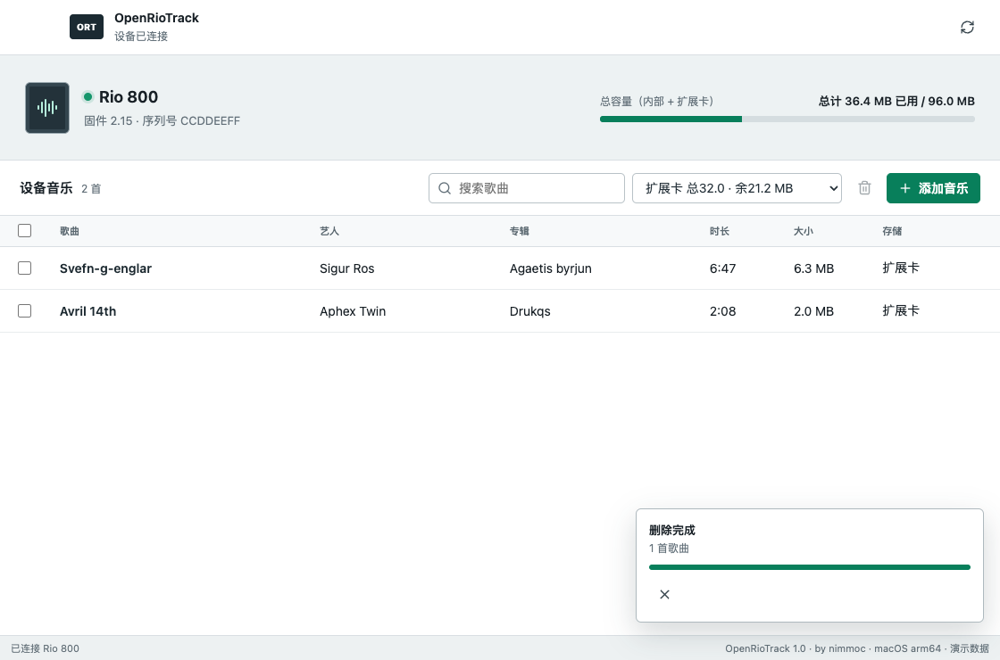

# OpenRioTrack

OpenRioTrack 是一款由 **nimmoc** 发起的 Rio 800 开源桌面管理工具，让这款早期 USB 音乐播放器可以直接连接现代 macOS。



## 它解决了什么

- **不再需要 Windows XP 虚拟机**：Rio 800 可以直接连接 Mac，无需启动 XP、安装原厂软件或手动安装驱动。
- **更稳定的设备连接**：改善 USB 通信和任务调度，降低歌曲传输过程中出现断连、进度停滞或界面卡顿的情况。
- **在电脑上管理设备歌曲**：连接播放器后，可以查看内置存储和扩展卡、浏览歌曲、添加 MP3，也可以勾选并删除设备中的歌曲。
- **良好的中英文支持**：能够识别中英文歌曲标题、艺人和专辑信息，并针对 Rio 800 实现中文标题显示兼容处理。

## 下载

前往 [GitHub Releases](https://github.com/nimmoc/openriotrack/releases) 下载最新的 macOS 压缩包。解压后双击 `OpenRioTrack.app`；如果 macOS 阻止首次启动，请在 Finder 中右键应用，选择“打开”，然后再次确认。

## 系统要求

- macOS 11 Big Sur 或更高版本
- Apple Silicon Mac（M1 或更新芯片）
- Rio 800 和 USB 数据线

当前完整的设备连接、歌曲传输、中文显示和删除测试在 Apple Silicon Mac 与 macOS 26.5.2 上完成。程序和底层 USB 后端的最低部署目标均为 macOS 11.0；macOS 11 至 15 尚需更多实机验证。

## 使用

1. 打开 Rio 800 并通过 USB 连接 Mac。
2. 启动 OpenRioTrack，等待软件读取设备容量和歌曲。
3. 选择内部存储或扩展卡。
4. 点击添加按钮，或把 MP3 文件直接拖入窗口。
5. 勾选歌曲后可以查看所选数量和容量，也可以批量删除。

如果界面显示“数据通道无响应”，请拔掉 USB，让播放器完全断电约 10 秒，然后重新开机连接。尽量直接连接 Mac，避免使用 USB 集线器。

## 开发

需要 Node.js 22 或更高版本以及 Xcode Command Line Tools。

安装依赖并使用演示数据启动：

```sh
npm ci
RIO_MANAGER_DEMO=1 npm start
```

运行测试：

```sh
npm test
npm run test:ui
```

构建 Apple Silicon macOS 应用：

```sh
npm run pack:mac
```

底层 `rioutil` 移植源码位于 `native/rioutil`。重新构建后端：

```sh
./native/rioutil/scripts/build-macos.sh
```

## 致谢

OpenRioTrack 的 Rio USB 协议后端基于 Nathan Hjelm 及贡献者维护的 [hjelmn/rioutil](https://github.com/hjelmn/rioutil)，并在其提交 `100860355caa921f2834e75284e1c04ca6cb1dcb` 基础上完成现代 macOS、Rio 800 中文标题和图形界面所需的适配。修改后的完整源码保存在 `native/rioutil`，原作者信息、版权头和历史文件均予以保留。

项目还使用了 [libusb](https://github.com/libusb/libusb)、[Lucide](https://github.com/lucide-icons/lucide) 和 [Electron](https://github.com/electron/electron)。详情见 [第三方声明](licenses/THIRD_PARTY_NOTICES.md)。
