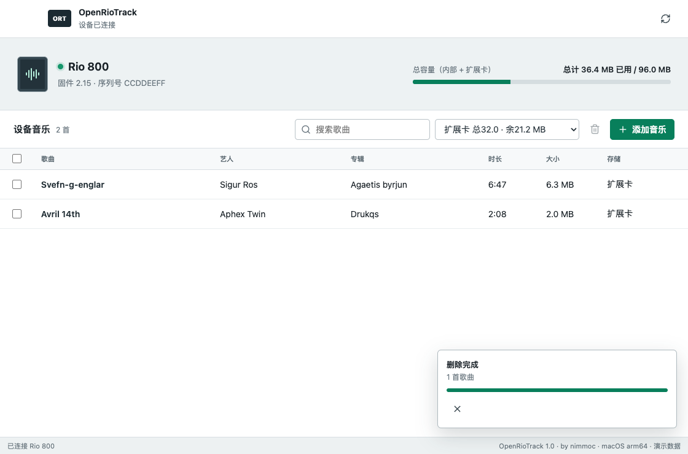

# OpenRioTrack

English | [简体中文](README.md)

OpenRioTrack is an open-source desktop manager for the Rio 800, created by **nimmoc**. It allows this early USB music player to connect directly to a modern Mac.



## What It Solves

- **No Windows XP virtual machine required**: Connect a Rio 800 directly to a Mac without launching Windows XP, installing the original software, or manually installing a driver.
- **More stable device connections**: Improved USB communication and task scheduling reduce disconnections, stalled progress, and interface freezes during music transfers.
- **Manage tracks from your computer**: View internal storage and expansion cards, browse tracks, add MP3 files, and select or remove tracks stored on the device.
- **Reliable Chinese and English support**: Recognizes Chinese and English track titles, artists, and albums, with dedicated compatibility handling for displaying Chinese titles on the Rio 800.

## Download

Visit [GitHub Releases](https://github.com/nimmoc/openriotrack/releases) to download the latest macOS archive. Extract it and double-click `OpenRioTrack.app`. If macOS blocks the app on first launch, Control-click the app in Finder, choose **Open**, and confirm once more.

## System Requirements

- macOS 11 Big Sur or later
- An Apple silicon Mac (M1 or newer)
- A Rio 800 and USB data cable

Complete testing of device connections, music transfers, Chinese text display, and track deletion was performed on an Apple silicon Mac running macOS 26.5.2. The application and its low-level USB backend both target macOS 11.0 or later. Additional hardware testing is still needed on macOS 11 through 15.

## Usage

1. Turn on the Rio 800 and connect it to your Mac over USB.
2. Launch OpenRioTrack and wait for it to read the device capacity and track list.
3. Select the internal storage or expansion card.
4. Click the add button, or drag MP3 files directly into the window.
5. Select tracks to view their total count and size, or remove them in a batch.

If the interface reports that the data channel is not responding, unplug the USB cable, leave the player completely disconnected from power for about 10 seconds, then turn it on and reconnect it. Connect the player directly to your Mac whenever possible and avoid USB hubs.

## Development

Development requires Node.js 22 or later and the Xcode Command Line Tools.

Install dependencies and launch with demo data:

```sh
npm ci
RIO_MANAGER_DEMO=1 npm start
```

Run the tests:

```sh
npm test
npm run test:ui
```

Build the Apple silicon macOS application:

```sh
npm run pack:mac
```

The ported `rioutil` source is located in `native/rioutil`. Rebuild the backend with:

```sh
./native/rioutil/scripts/build-macos.sh
```

## Acknowledgements

OpenRioTrack's Rio USB protocol backend is based on [hjelmn/rioutil](https://github.com/hjelmn/rioutil), maintained by Nathan Hjelm and its contributors. The port builds on commit `100860355caa921f2834e75284e1c04ca6cb1dcb`, with adaptations for modern macOS, Chinese Rio 800 track titles, and the graphical interface. The complete modified source is included in `native/rioutil`, with the original attribution, copyright headers, and historical files preserved.

This project also uses [libusb](https://github.com/libusb/libusb), [Lucide](https://github.com/lucide-icons/lucide), and [Electron](https://github.com/electron/electron). See [Third-Party Notices](licenses/THIRD_PARTY_NOTICES.md) for details.
